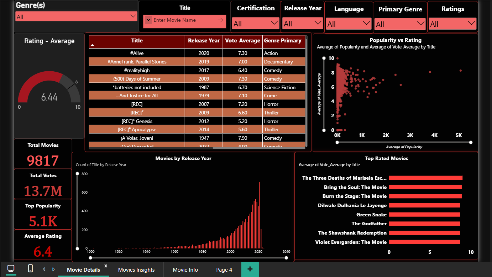
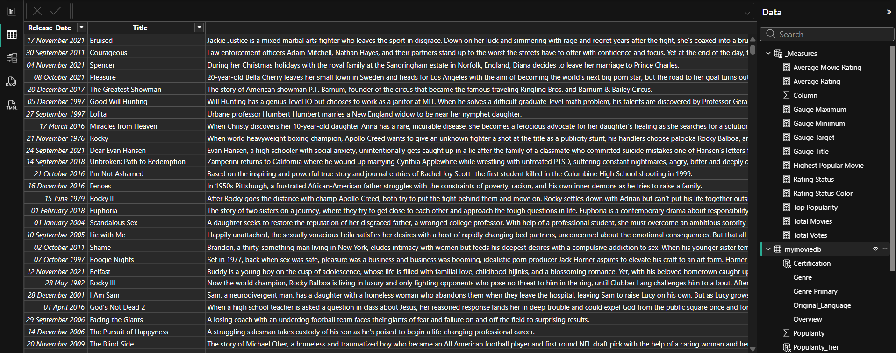
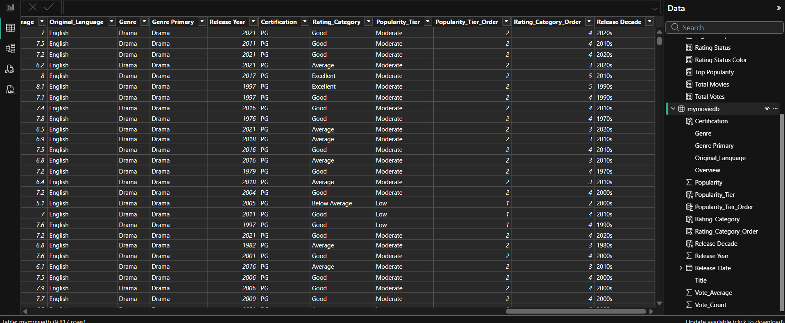
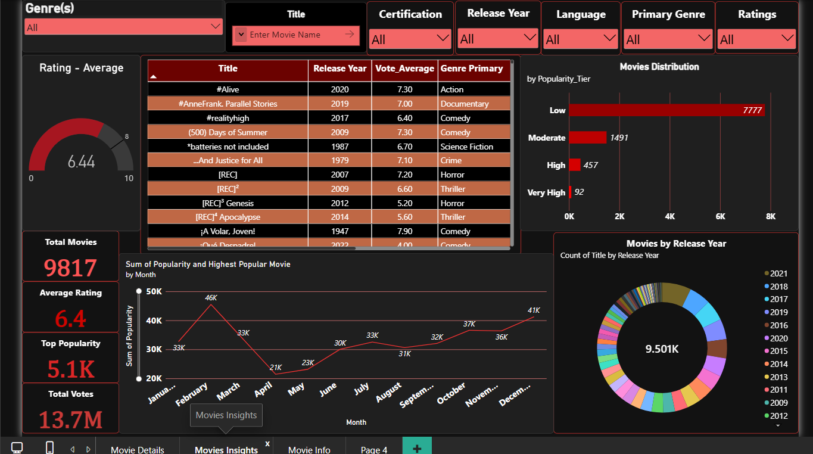
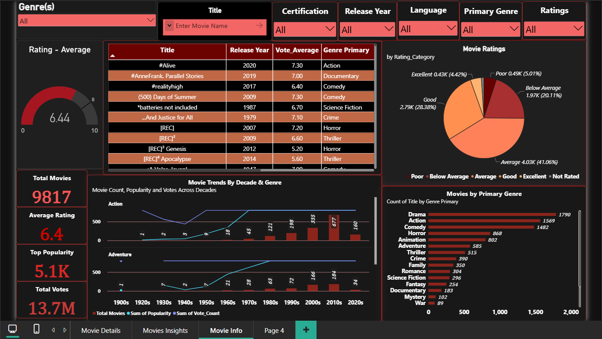

# 🎬 Movie Analytics and Insights

An interactive, 3-page **Power BI** dashboard that analyses a catalogue of **9,817 movies** by genre, rating, popularity, votes and release year.

| | |
|---|---|
| **Student Name** | Pratham Deep |
| **Registration Number** | PIET24CD063 |
| **Batch / Roll No.** | G3 / 063 |
| **Project Title** | Movie Analytics and Insights |
| **Tool Used** | Microsoft Power BI Desktop (Power Query, Data Modeling, DAX) |



---

## 📌 Table of Contents
1. [Project Overview](#-project-overview)
2. [Dataset Description](#-dataset-description)
3. [Objectives](#-objectives)
4. [Data Cleaning Performed](#-data-cleaning-performed)
5. [Data Model](#-data-model)
6. [DAX Measures](#-dax-measures)
7. [Dashboard Pages & Screenshots](#-dashboard-pages--screenshots)
8. [Key Findings](#-key-findings)
9. [Conclusion](#-conclusion)
10. [Repository Structure](#-repository-structure)
11. [How to Open the Project](#-how-to-open-the-project)

---

## 📖 Project Overview
This project turns a raw movie dataset into an interactive Business Intelligence report. It answers questions such as *Which genres dominate the catalogue? How are movies rated? How popular are they? How has movie production changed over the years?* The report has three pages and seven slicers (Genre(s), Title search, Certification, Release Year, Language, Primary Genre and Ratings), so every visual can be filtered together.

| KPI | Value |
|---|---|
| Total Movies | **9,817** |
| Total Votes | **13.7M** |
| Average Rating | **6.4** (gauge: 6.44 / 10) |
| Top Popularity | **5.1K** |

## 📂 Dataset Description
- **Source file:** `Dataset/mymoviedb.csv` (raw) and `Dataset/dataset.xlsx` (cleaned workbook with data dictionary and summary).
- **Size:** 9,827 movie records in the source file, **9,817 movies** in the Power BI model.
- **Coverage:** movies released from **1902 to 2024**, in **43 original languages** (English is about 77%), across **19 genres**.

| Column | Description |
|---|---|
| `Release_Date` | Release date of the movie |
| `Title` | Movie title |
| `Overview` | Short plot summary |
| `Popularity` | Popularity score |
| `Vote_Count` | Number of votes received |
| `Vote_Average` | Average rating on a 0–10 scale |
| `Original_Language` | Original language code (en, ja, es, fr, ko …) |
| `Genre` | All genres of the movie (comma separated) |
| `Poster_Url` | Poster link (not used in the report) |

Columns added during preparation: `Genre Primary`, `Release Year`, `Release Decade`, `Rating_Category`, `Popularity_Tier` (plus sort-order columns and `Certification`). See `Dataset/dataset.xlsx → Data_Dictionary` for the full definition.

## 🎯 Objectives
- Build one overview of total movies, total votes, average rating and top popularity.
- Understand how movie releases have grown over the years and decades.
- Classify movies by rating quality (Poor → Excellent) and by popularity tier (Low → Very High).
- Identify the top-rated movies and the most common genres.
- Study the relationship between popularity and rating.
- Provide interactive exploration with slicers, a movie-title search box and drill-through.
- Convert raw movie data into clear, actionable insights.

## 🧹 Data Cleaning Performed
Data preparation was done in the **Power Query Editor** (steps in [`DAX/power_query_steps.m`](DAX/power_query_steps.m)):

1. Loaded the CSV and promoted the first row to headers.
2. Set correct data types (date, whole number, decimal, text).
3. Removed broken and blank rows. One record (*Pixie Hollow Bake Off*) has an overview that wraps over 11 lines in the CSV and loads as null fragments.
4. Dropped `Poster_Url`, which is not used in the report.
5. Created **Genre Primary** (first listed genre) and **Release Year** from the existing columns.
6. Created **Release Decade**, **Rating_Category** and **Popularity_Tier** (with sort-order helper columns) as calculated columns.
7. Kept the 100 movies with 0 votes and labelled them **Not Rated** instead of deleting them.
8. Kept titles with special characters (e.g. `#Alive`, `[REC]`, `*batteries not included`) because they are genuine titles.

**Result:** 9,827 source records → **9,817 movies** in the final model.

## 🧩 Data Model
A simple model with one fact table and one measures table:

| Table | Role | Main fields |
|---|---|---|
| `mymoviedb` | Fact table | Release_Date, Title, Overview, Popularity, Vote_Count, Vote_Average, Original_Language, Genre, Genre Primary, Release Year, Release Decade, Certification, Rating_Category, Rating_Category_Order, Popularity_Tier, Popularity_Tier_Order |
| `_Measures` | Measures table | Total Movies, Total Votes, Average Rating, Average Movie Rating, Top Popularity, Highest Popular Movie, Gauge Minimum / Maximum / Target / Title, Rating Status, Rating Status Color |

| Tables & measures | Columns |
|---|---|
|  |  |

## 🧮 DAX Measures
All DAX code is in [`DAX/dax_measures.dax`](DAX/dax_measures.dax). Core measures:

```DAX
Total Movies          = COUNTROWS ( mymoviedb )
Total Votes           = SUM ( mymoviedb[Vote_Count] )
Average Rating        = AVERAGE ( mymoviedb[Vote_Average] )
Top Popularity        = MAX ( mymoviedb[Popularity] )
Highest Popular Movie =
    VAR _Top = TOPN ( 1, VALUES ( mymoviedb[Title] ), CALCULATE ( MAX ( mymoviedb[Popularity] ) ), DESC )
    RETURN MAXX ( _Top, mymoviedb[Title] )
```

Rating and popularity classification (calculated columns):

| Rating_Category | Rule | | Popularity_Tier | Rule |
|---|---|---|---|---|
| Not Rated | 0 votes | | Low | below 40 |
| Poor | below 5 | | Moderate | 40 to below 100 |
| Below Average | 5 to below 6 | | High | 100 to below 300 |
| Average | 6 to below 7 | | Very High | 300 and above |
| Good | 7 to below 8 | | | |
| Excellent | 8 and above | | | |

## 🖥️ Dashboard Pages & Screenshots

### Page 1 – Movie Details
Slicers, rating gauge, movie table, **Popularity vs Rating** scatter plot, KPI cards, **Movies by Release Year** and **Top Rated Movies**.


### Page 2 – Movies Insights
**Movies Distribution** by popularity tier, **monthly popularity trend** with the most popular movie, and a donut chart of movies by release year.



### Page 3 – Movie Info
**Movie Ratings** by category, **Movie Trends by Decade & Genre**, and **Movies by Primary Genre**.



## 🔍 Key Findings
- **Scale:** 9,817 movies with 13.7M votes; the average rating is **6.44 / 10**, below the gauge target of 8.
- **Ratings are mostly middle-of-the-road:** Average (41.06%) and Good (28.38%) make up about 69% of movies; only 4.42% are Excellent and 5.01% are Poor.
- **Most movies are not very popular:** 7,777 movies (about 79%) are in the Low popularity tier, 1,491 Moderate, 457 High and just **92 Very High**.
- **Popularity does not guarantee quality:** the scatter plot shows the highest ratings (around 9) belonging to movies with very low popularity, while the few very popular movies (2K–5K) are rated about 6–8.5.
- **Drama, Action and Comedy lead:** 1,790 + 1,569 + 1,482 movies, together about **49%** of the catalogue. Horror (868) and Animation (802) follow.
- **Production has grown sharply:** releases rise steeply after 1980 and peak at over 700 movies in 2021. Action releases grew from 121 (1980s) to 677 (2010s).
- **Monthly popularity pattern:** total popularity peaks in February (46K), dips in April (21K) and climbs back to 41K by December.
- **Top-rated titles** include *The Godfather*, *The Shawshank Redemption*, *Dilwale Dulhania Le Jayenge*, *Bring the Soul: The Movie* and *Burn the Stage: The Movie*.

## ✅ Conclusion
The dashboard shows that the catalogue is dominated by average-quality, low-popularity titles, that Drama, Action and Comedy lead the genre mix, and that movie production grew sharply in recent decades. A small number of highly popular and highly rated movies stand out against this long tail. The project demonstrates the full BI workflow: data cleaning in Power Query, modelling, DAX measures and calculated columns, and interactive storytelling in Power BI.

**Future improvements:** add budget and revenue data for profitability analysis, forecasts for releases and popularity, language- and certification-wise pages, and publish to Power BI Service with scheduled refresh.

## 🗂️ Repository Structure
```
Movie-Analytics-and-Insights
│
├── README.md
├── Dataset/
│   ├── dataset.xlsx            (cleaned data + data dictionary + summary)
│   └── mymoviedb.csv           (raw source file)
│
├── PowerBI/
│   └── Movie_analytics.pbix
│
├── DAX/
│   ├── dax_measures.dax        (measures + calculated columns)
│   └── power_query_steps.m     (data preparation steps)
│
├── Screenshots/
│   ├── 01_Movie_Details.png
│   ├── 02_Movies_Insights.png
│   ├── 03_Movie_Info.png
│   ├── 04_Data_View_Tables_and_Measures.png
│   └── 05_Data_View_Columns.png
│
└── Report/
    └── Movie_Analytics_Project_Report.pdf
```

## ▶️ How to Open the Project
1. Download or clone this repository.
2. Install **Microsoft Power BI Desktop** (free).
3. Open `PowerBI/Movie_analytics.pbix`.
4. If Power BI asks for the data location, point it to `Dataset/mymoviedb.csv`, then click **Refresh**.

---
*Prepared by **Pratham Deep** · Reg. No. **PIET24CD063***
